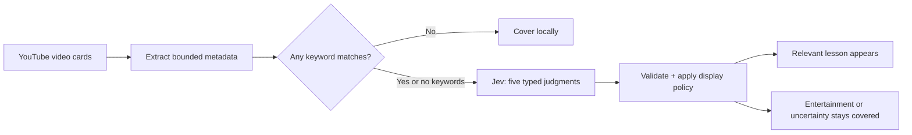

<p align="center"></p>

<p align="center"><strong>A premium Chrome extension that keeps YouTube focused on learning.</strong><br>Built with TypeScript, Manifest V3 and Jev's typed judgments.</p>

<p align="center"><a href="https://raw.githubusercontent.com/krishnakant2607/study-mode-jev/main/downloads/study-mode-extension.zip">Download install ZIP</a> · <a href="#get-started">Get started</a> · <a href="DEMO.md">Demo runbook</a> · <a href="docs/ARCHITECTURE.md">Architecture</a> · <a href="TEST_REPORT.md">Test report</a></p>

## The idea

You open YouTube to learn Python or DSA. The feed has other plans. Study Mode lets you add several keywords with Enter, then covers entertainment and unrelated recommendations while keeping relevant lessons visible.

Matching a keyword is only the first step. A Python snake spectacle or DSA meme compilation can match the text and still be covered. Jev evaluates the apparent learning purpose; deterministic code validates the answers and controls what appears.


*Screenshot of the offline rehearsal. Sample videos and judgments are authored; they are not presented as live Jev results.*

## What ships

| Feature | Behavior |
| --- | --- |
| Multiple keywords | Add `python`, press Enter, add `dsa`. Match any active keyword; remove individual chips. |
| Full-card covers | Hide thumbnail, title, channel text and hover interaction together. |
| Jev judgments | Five typed questions assess teaching, entertainment, relevance, clickbait and evidence. |
| Conservative uncertainty | Unknown decisions, missing keys and API failures keep recognized candidates covered. |
| Popup + sidebar | A compact charcoal/orange UI with Focus, Activity and Settings. |
| Honest activity | Unique-video counts and reasons; no invented time-saved metric. |
| Offline rehearsal | Separate settings and counters, explicitly labelled authored decisions. |

## Get started

**Chrome 116 or later.** No server is needed for the installed extension.

### Install the packaged build

1. Download the **[ready-to-install ZIP](https://raw.githubusercontent.com/krishnakant2607/study-mode-jev/main/downloads/study-mode-extension.zip)**, then extract it. No npm or build step is needed.
2. Open `chrome://extensions`, enable **Developer mode**, and choose **Load unpacked**.
3. Select the extracted `study-mode` folder. Pin the extension.
4. Open **Settings**, enter your TypeSafe API key privately, choose **Save key**, then **Test connection**.
5. In **Focus**, enter `python` → Enter, then `dsa` → Enter. Enable Study Mode and reload YouTube.

Keywords filter recognized cards on the current page, including search results. Adding a chip does not run a new YouTube search. **Open YouTube** starts a search using the active keywords. With no keywords, general educational content is eligible.

### If you used Code → Download ZIP

Extract the repository ZIP, open `chrome://extensions`, enable **Developer mode**, click **Load unpacked**, and select **`chrome-extension` inside the extracted repository**. That folder already contains the compiled scripts and `manifest.json`. Do not select the repository root, `src`, or `public`.

You can also find the install ZIP at `downloads/study-mode-extension.zip` in the repository.

### Build from source

```sh
npm ci
npm run build
```

Load `dist` through **Load unpacked**. After source changes, rebuild, reload the extension card and reload existing YouTube tabs.

### Try the offline preview

```sh
npm run build
npm run preview
```

Open **http://127.0.0.1:4178/demo.html**. The preview needs no key and cannot perform live inference. The installed extension also includes **Rehearse demo**.

## Why Jev fits

Jev handles a bounded decision in the middle: text metadata enters, typed answers return, code chooses whether to cover or reveal. The extension uses the [official TypeSafe HTTP API](https://docs.typesafe.ai/api), not free-form generated instructions. There are no additional AI providers or shared bundled keys.



## Verification and demo readiness

```sh
npm run typecheck
npm test
npm run package
```

**17 automated tests and 9 isolated Chromium checks passed** with authored fixtures and a mocked API transport. CI runs type checking, logic/worker tests and packaging; its artifact contains the extension ZIP. Browser tests can be run separately using [CONTRIBUTING.md](CONTRIBUTING.md).

**Live Jev access, real YouTube layout coverage and decision quality still need testing with your key and Chrome profile.** Metadata can misrepresent a video. The extension covers recognized desktop recommendation cards; it does not censor playing-video frames, subtitles, comments or the dedicated Shorts player, and does not enforce parental controls. See the [test report](TEST_REPORT.md) and [demo runbook](DEMO.md) before presenting.

## Privacy

Your key stays in extension-owned local storage and never reaches content scripts or the repository. Eligible text metadata and keywords go directly to TypeSafe. The local cache retains metadata; Activity retains IDs and decisions. No transcript, audio, thumbnail image or whole-page HTML is sent. [More detail →](docs/ARCHITECTURE.md#privacy-and-permissions)

## Project structure

```text
src/                  Typed policy, Jev worker, card detection, UI and rehearsal
public/               Panel markup, styles, icons and demo shell
tests/                Logic, worker and isolated browser tests
scripts/              Build, local preview and ZIP packaging
chrome-extension/     Compiled extension ready for Load unpacked
downloads/            Directly downloadable install ZIP
.github/workflows/    Continuous integration
.impeccable/          Design-system metadata
docs/                 Architecture and actual UI captures
manifest.json         Chrome Manifest V3 permissions and entry points
PRODUCT.md            Product scope and decisions
DESIGN.md             Implemented visual system
DEMO.md               Hackathon presentation and recovery plan
TEST_REPORT.md        Verification evidence and remaining live checks
```

See [CONTRIBUTING.md](CONTRIBUTING.md) for development and [CHANGELOG.md](CHANGELOG.md) for the initial release.
