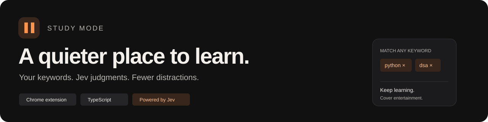
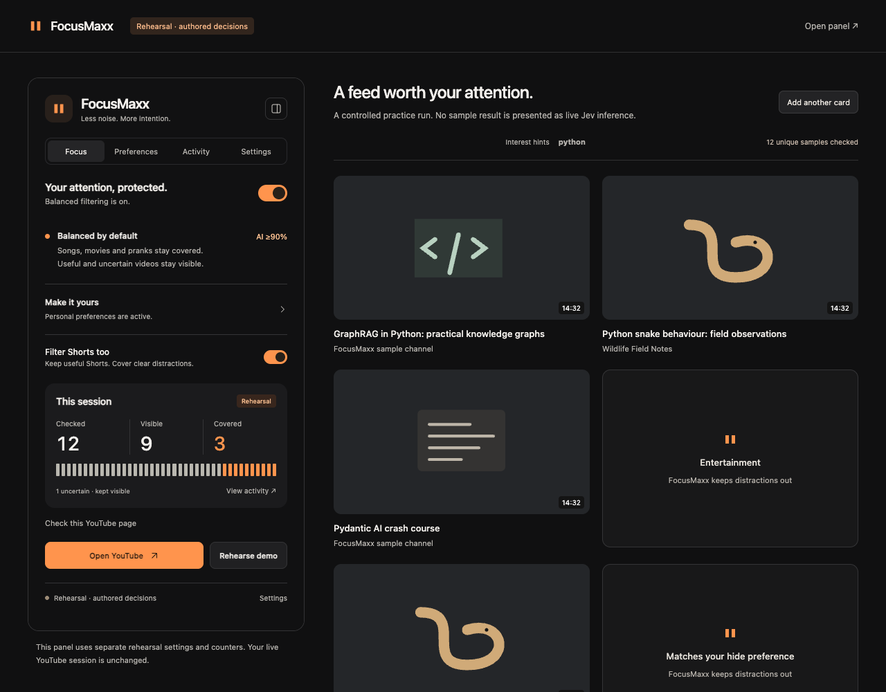
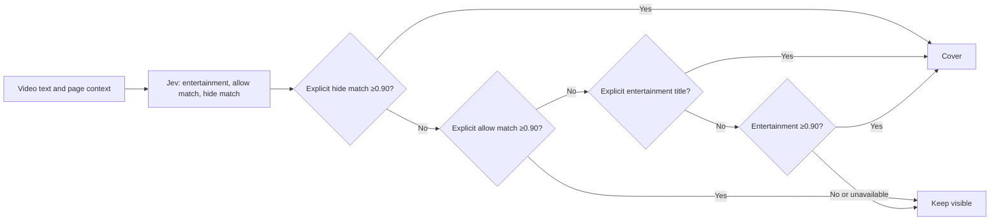

<p align="center"></p>

<p align="center"><strong>A premium Chrome extension that keeps YouTube focused on learning.</strong><br>Built with TypeScript, Manifest V3 and Jev's typed judgments.</p>

<p align="center"><a href="https://raw.githubusercontent.com/krishnakant2607/study-mode-jev/main/downloads/focusmaxx-extension.zip">Download install ZIP</a> · <a href="#get-started">Get started</a> · <a href="DEMO.md">Demo runbook</a> · <a href="docs/ARCHITECTURE.md">Architecture</a> · <a href="TEST_REPORT.md">Test report</a></p>

## The idea

A useful video does not have to look like a lecture. FocusMaxx keeps tutorials, technical discussions, documentaries, research observations and uncertain content visible, while covering clearly unwanted entertainment.

Personalize it with two plain-language fields: **what you want to see** and **what you want to hide**. A wildlife researcher can allow snake observations while excluding music videos. Keywords are optional interest hints, never literal gates. Clickbait-style titles are not filtered.



*The screenshot shows fictional videos with explicitly authored judgments, not live Jev results.*

## What ships

| Feature | Behavior |
| --- | --- |
| Balanced default | Clearly labelled entertainment categories are covered directly; other entertainment requires an AI judgment ≥0.90. |
| Positive/negative preferences | Explicit exclusions win, then explicit allowances override the generic entertainment rule. |
| Optional keyword hints | Add chips with Enter. Missing keyword matches never block content. |
| Individual Shorts | Recognized modern/legacy cards and an active vertical viewer use the same policy. Blocked player media pauses. |
| Premium panel | Charcoal/orange popup and sidebar with Focus, Preferences, Activity and Settings. |
| Honest activity | Unique visible/covered outcomes; no invented time-saved metric. |
| Offline rehearsal | Authored decisions, separate settings/counters, clear labelling. |

## Get started

**Chrome 116 or later.** No server is needed for the installed extension.

### Install the packaged build

1. Download the **[ready-to-install ZIP](https://raw.githubusercontent.com/krishnakant2607/study-mode-jev/main/downloads/focusmaxx-extension.zip)**, then extract it. No npm or build step is needed.
2. Open `chrome://extensions`, enable **Developer mode**, and choose **Load unpacked**.
3. Select the extracted `focusmaxx` folder. Pin the extension.
4. Open **Settings**, enter your TypeSafe API key privately, choose **Save key**, then **Test connection**.
5. Enable FocusMaxx in **Focus**. In **Preferences**, optionally enter what to allow/hide and click **Save preferences**. Reload YouTube.

No preferences are required: Balanced mode works by default, and blank preference fields send no preference questions. Optional hints add context and can seed the **Open YouTube** search. They never restrict the current page to literal matches.

### If you used Code → Download ZIP

Extract the repository ZIP, open `chrome://extensions`, enable **Developer mode**, click **Load unpacked**, and select **`chrome-extension` inside the extracted repository**. That folder already contains the compiled scripts and `manifest.json`. Do not select the repository root, `src`, or `public`.

You can also find the install ZIP at `downloads/focusmaxx-extension.zip` in the repository.

### Build from source

```sh
npm ci
npm run build
```

Load `dist` through **Load unpacked**. After source changes, rebuild, reload the extension card and reload existing YouTube tabs.

### Try the offline preview

```sh
npm run build
npm run preview
```

Open **http://127.0.0.1:4178/demo.html**. The preview needs no key and cannot perform live inference. The installed extension also includes **Rehearse demo**.

## Why Jev fits

Jev handles a bounded decision in the middle: text metadata enters, typed answers return, code chooses whether to cover or reveal. The extension uses the [official TypeSafe HTTP API](https://docs.typesafe.ai/api), not free-form generated instructions. There are no additional AI providers or shared bundled keys.



## If videos are not being covered

Enable FocusMaxx on a real YouTube tab, then use **Check this YouTube page** in the popup or sidebar. It reports detected/readable cards, evaluated decisions, unavailable calls and the highest entertainment scores among still-visible videos. It never exposes credentials or covered titles. Scores below 90% stay visible unless the title matches an explicit entertainment category. Informative title markers bypass that local rule; Jev still evaluates them. With blank preferences, explicit category rules work without an API call. **Activity source** changes only the statistics you view; preferences always belong to the current live or explicitly labelled demo panel.

## Verification and demo readiness

```sh
npm run typecheck
npm test
npm run package
```

**18 automated tests and 12 isolated Chromium checks passed** with authored fixtures and a mocked API transport. CI runs type checking, logic/worker tests and packaging; its artifact contains the extension ZIP. Browser tests can be run separately using [CONTRIBUTING.md](CONTRIBUTING.md).

**Live Jev access, real YouTube layout coverage and decision quality still need testing with your key and Chrome profile.** Metadata can misrepresent a video. The extension covers recognized desktop recommendation cards; it does not inspect playing-video frames, subtitles or comments, and does not enforce parental controls. See the [test report](TEST_REPORT.md) and [demo runbook](DEMO.md) before presenting.

## Privacy

Your key stays in extension-owned local storage and never reaches content scripts or the repository. Eligible text metadata and preferences go directly to TypeSafe. The local cache retains metadata; Activity retains IDs and decisions. No transcript, audio, thumbnail image or whole-page HTML is sent. [More detail →](docs/ARCHITECTURE.md#privacy-and-permissions)

## Project structure

```text
src/                  Typed policy, Jev worker, card detection, UI and rehearsal
public/               Panel markup, styles, icons and demo shell
tests/                Logic, worker and isolated browser tests
scripts/              Build, local preview and ZIP packaging
chrome-extension/     Compiled extension ready for Load unpacked
downloads/            Directly downloadable install ZIP
.github/workflows/    Continuous integration
.impeccable/          Design-system metadata
docs/                 Architecture and actual UI captures
manifest.json         Chrome Manifest V3 permissions and entry points
PRODUCT.md            Product scope and decisions
DESIGN.md             Implemented visual system
DEMO.md               Hackathon presentation and recovery plan
TEST_REPORT.md        Verification evidence and remaining live checks
```

See [CONTRIBUTING.md](CONTRIBUTING.md) for development and [CHANGELOG.md](CHANGELOG.md) for the initial release.
